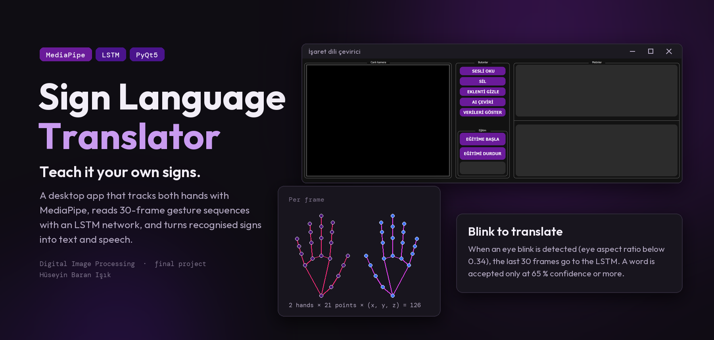
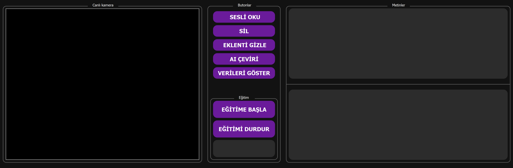
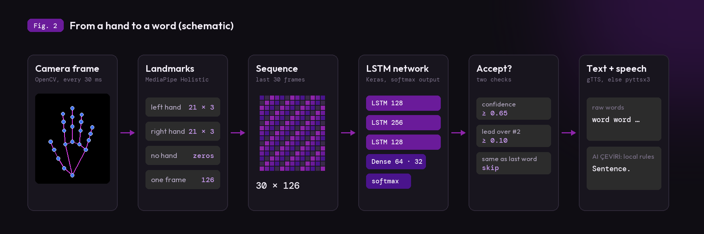
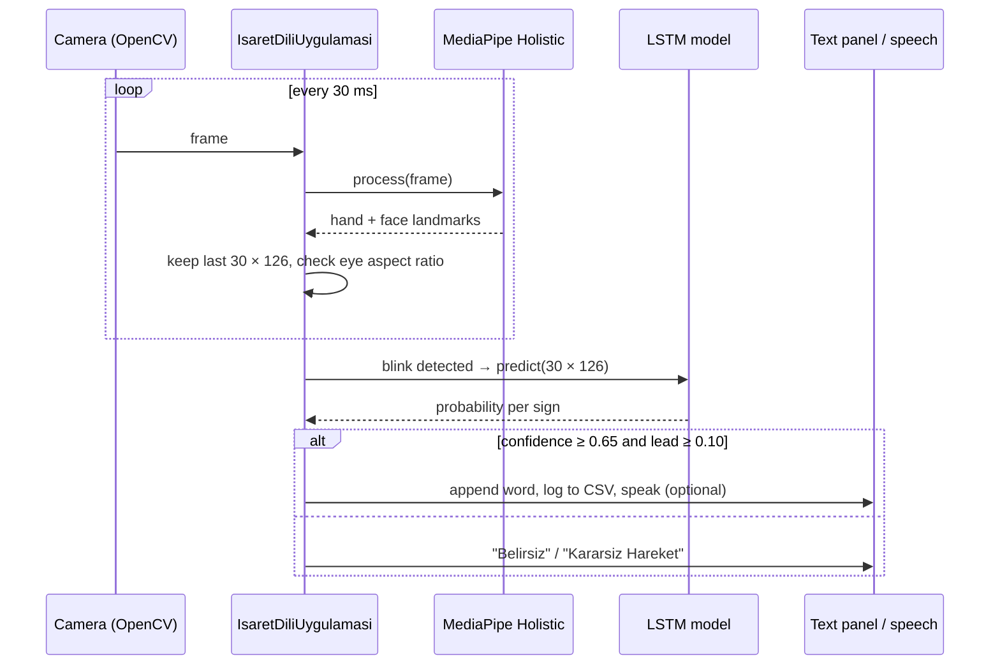
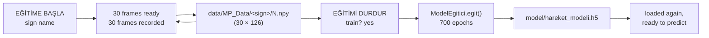
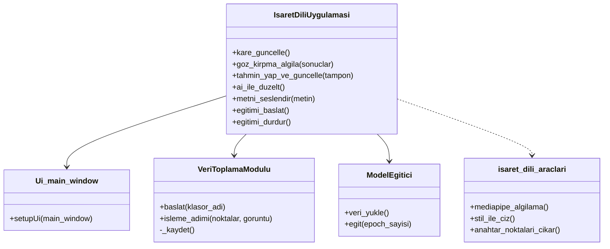
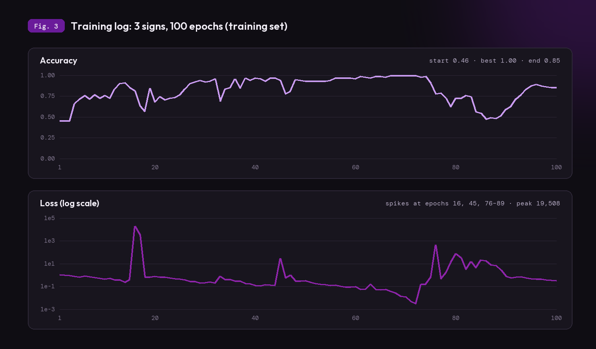

<p align="center">
  
</p>

<p align="center">
  <a href="#demo">Demo</a> &nbsp;·&nbsp;
  <a href="#how-it-works">How it works</a> &nbsp;·&nbsp;
  <a href="#run-it">Run it</a> &nbsp;·&nbsp;
  <a href="#known-limits">Limits</a> &nbsp;·&nbsp;
  <a href="#türkçe">Türkçe</a>
</p>

**Sign Language Translator** is a desktop app that recognises sign language gestures from a webcam in real
time. MediaPipe tracks both hands, an LSTM network classifies 30-frame gesture sequences, and every recognised
sign is written as text and can be read aloud. Instead of a fixed dataset, you record your own signs in the app
and train the model from the same window.

It is the final project of the **Digital Image Processing** course (2026).

<br>

## Demo

<p align="center">
  
</p>

This is the real window, rendered from `IsaretDiliProjesi/src/arayuz.py` by
[`tools/capture_ui.py`](tools/capture_ui.py). The camera panel is black because no camera was open.

> [!NOTE]
> There is no recording of live recognition yet. It needs a webcam and a trained model, and neither the
> model (`model/hareket_modeli.h5`) nor the recorded signs (`data/MP_Data/`) are in this repository.

<br>

## What it does

<table>
<tr><td width="28%"><b>Hand tracking</b></td><td>MediaPipe Holistic finds both hands in every camera frame (OpenCV, every 30 ms) and draws their 21 landmarks. <b>EKLENTİ GİZLE</b> hides the drawing.</td></tr>
<tr><td><b>Blink to translate</b></td><td>The app keeps the last 30 frames. When it sees an eye blink (eye aspect ratio below 0.34), it sends them to the LSTM. After a prediction it waits about 60 frames before the next one.</td></tr>
<tr><td><b>Careful answers</b></td><td>A sign is accepted only if the model is at least 65 % sure and at least 10 points ahead of the second guess. Otherwise it shows "Belirsiz Hareket" or "Kararsiz Hareket". The same word twice in a row is skipped.</td></tr>
<tr><td><b>Train your own signs</b></td><td>Type a name in the <b>Eğitim</b> box and press <b>EĞİTİME BAŞLA</b>. The app repeats: 30 frames to get ready (yellow bar), then 30 frames recorded (red bar), saved as one <code>.npy</code> file. <b>EĞİTİMİ DURDUR</b> stops and offers to train the model.</td></tr>
<tr><td><b>Text and speech</b></td><td>Words are added to the top text panel. <b>SESLİ OKU</b> reads them aloud with gTTS, or pyttsx3 when gTTS is not available.</td></tr>
<tr><td><b>Sentence cleanup</b></td><td><b>AI ÇEVİRİ</b> writes a tidier sentence in the lower panel: it removes repeated words, fixes a few known phrases ("ben iyi" → "Ben iyiyim") and adds punctuation. These are local rules, not a language model.</td></tr>
<tr><td><b>History</b></td><td>Every accepted sign is appended to <code>data/Hareket_Gecmisi.csv</code> with date, time and confidence.</td></tr>
</table>

<br>

## How it works

<p align="center">
  
</p>

**From frame to numbers.** For each frame, MediaPipe returns 21 points per hand with x, y and z. The app
flattens them into 126 numbers (63 for the left hand, 63 for the right). A hand that is not visible becomes
63 zeros (`anahtar_noktalari_cikar` in `isaret_dili_araclari.py`).

**From numbers to a word.** The last 30 frames form a 30 × 126 sequence. A blink starts a prediction in a
background thread, so the window does not freeze:



**Training.** Recorded signs are folders of `.npy` files; the folder name is the sign's name.



The network in [`model_egitimi.py`](IsaretDiliProjesi/src/model_egitimi.py): three LSTM layers (128, 256, 128
units, ReLU, dropout 0.3), two dense layers (64, 32) and a softmax over the signs, trained with Adam and
categorical cross-entropy.

**Code structure.**



### What the training log shows

<p align="center">
  
</p>

The repository includes one TensorBoard log (`IsaretDiliProjesi/Logs/train`, 2 January 2026). It was made by
an earlier, smaller version of the network (LSTM 64, 128, 64; 3 signs; 100 epochs). Accuracy is measured on the
training data only. The run was unstable: loss jumped at epochs 16, 45 and 76–89 (up to 19,508), and accuracy
fell from 1.00 to 0.85 by the end. The figure is drawn by [`tools/render_figures.py`](tools/render_figures.py)
from the numbers in [`tools/training_log.json`](tools/training_log.json), which were read from that log.

<br>

## Run it

Python with OpenCV, NumPy, PyQt5, MediaPipe, TensorFlow, gTTS, pyttsx3 and scikit-learn, plus a webcam.

```bash
pip install -r IsaretDiliProjesi/requirements.txt
mkdir IsaretDiliProjesi/model          # the trainer saves hareket_modeli.h5 here
cd IsaretDiliProjesi/src
python ana_program.py
```

`baslat.bat` does the same, but it points to a fixed Anaconda path (`C:\Users\win\anaconda3\envs\isaret_dili_clean`);
change that path for your computer.

**First use:** type a sign's name in the **Eğitim** box, press **EĞİTİME BAŞLA**, and repeat the sign each time
the bar turns red. Record several signs this way, press **EĞİTİMİ DURDUR** and answer **Yes** to train. Then sign
in front of the camera and blink to get a translation.

<br>

## Known limits

- **No model or data in the repo.** You must record signs and train before the app can recognise anything.
- **Training is not evaluated.** `egit()` keeps 5 % of the samples aside but never measures them, so there is no
  test accuracy. The logged run (Fig. 3) shows unstable loss.
- **VERİLERİ GÖSTER deletes files.** Besides showing counts, it permanently deletes samples with more than 15
  empty frames.
- **"AI ÇEVİRİ" is rule-based.** A Gemini API call (`gemini_api_cagir`) exists in the code but is not used.
  `test_models.py` needs `google-generativeai`, which is not in `requirements.txt`.
- **Only hands are used for signs.** The face is used just for blink detection; body pose is ignored.

<br>

## Credits

- Final project of the **Digital Image Processing** course, by Hüseyin Baran Işık.
- Hand and face tracking: [MediaPipe](https://github.com/google-ai-edge/mediapipe) Holistic (Google).
- Figures set in Outfit and DM Mono, both under the SIL Open Font License ([`tools/fonts/`](tools/fonts/)).
  Colours are taken from the app's own Qt stylesheet and MediaPipe drawing colours.

<br>

---

## Türkçe

**İşaret Dili Tercümanı**, işaret dili hareketlerini web kamerasından gerçek zamanlı tanıyan bir masaüstü
uygulamasıdır. MediaPipe iki eli izler, bir LSTM ağı 30 karelik hareket dizilerini sınıflandırır ve tanınan
her işaret metne yazılır, istenirse sesli okunur. Sabit bir veri seti yerine kendi işaretlerini uygulamada
kaydeder ve modeli aynı pencereden eğitirsin.

**Sayısal Görüntü İşleme** dersinin final projesidir (2026).

### Demo

Yukarıdaki pencere görüntüsü gerçektir; `IsaretDiliProjesi/src/arayuz.py` dosyasından
[`tools/capture_ui.py`](tools/capture_ui.py) ile çizildi. Kamera açık olmadığı için kamera paneli siyah.

> [!NOTE]
> Canlı tanımanın kaydı henüz yok. Bunun için web kamerası ve eğitilmiş bir model gerekiyor; model
> (`model/hareket_modeli.h5`) ve kaydedilmiş işaretler (`data/MP_Data/`) bu repoda yok.

### Ne yapıyor

<table>
<tr><td width="28%"><b>El takibi</b></td><td>MediaPipe Holistic her kamera karesinde (OpenCV, 30 ms'de bir) iki eli bulur ve 21 noktasını çizer. <b>EKLENTİ GİZLE</b> çizimi gizler.</td></tr>
<tr><td><b>Göz kırp, çevir</b></td><td>Uygulama son 30 kareyi tutar. Göz kırpmayı gördüğünde (göz açıklık oranı 0.34'ün altında) bu kareleri LSTM'e gönderir. Bir tahminden sonra bir sonrakine kadar yaklaşık 60 kare bekler.</td></tr>
<tr><td><b>Temkinli cevap</b></td><td>Bir işaret yalnızca model en az %65 eminse ve ikinci tahminin en az 10 puan önündeyse kabul edilir. Değilse "Belirsiz Hareket" ya da "Kararsiz Hareket" yazar. Aynı kelime art arda eklenmez.</td></tr>
<tr><td><b>Kendi işaretini eğit</b></td><td><b>Eğitim</b> kutusuna bir ad yaz ve <b>EĞİTİME BAŞLA</b>'ya bas. Uygulama sürekli tekrarlar: hazırlanmak için 30 kare (sarı çubuk), sonra 30 kare kayıt (kırmızı çubuk), her biri bir <code>.npy</code> dosyası. <b>EĞİTİMİ DURDUR</b> kaydı bitirir ve modeli eğitmeyi önerir.</td></tr>
<tr><td><b>Metin ve ses</b></td><td>Kelimeler üstteki metin paneline eklenir. <b>SESLİ OKU</b> bunları gTTS ile, gTTS yoksa pyttsx3 ile okur.</td></tr>
<tr><td><b>Cümle düzeltme</b></td><td><b>AI ÇEVİRİ</b> alttaki panele daha düzgün bir cümle yazar: tekrar eden kelimeleri siler, bilinen birkaç ifadeyi düzeltir ("ben iyi" → "Ben iyiyim") ve noktalama ekler. Bunlar yerel kurallardır, bir dil modeli değildir.</td></tr>
<tr><td><b>Geçmiş</b></td><td>Kabul edilen her işaret tarih, saat ve güven oranıyla <code>data/Hareket_Gecmisi.csv</code> dosyasına eklenir.</td></tr>
</table>

### Nasıl çalışıyor

**Kareden sayılara.** MediaPipe her karede her el için x, y, z değerli 21 nokta döndürür. Uygulama bunları 126
sayıya düzleştirir (63 sol el, 63 sağ el). Görünmeyen el 63 sıfır olur (`isaret_dili_araclari.py` içindeki
`anahtar_noktalari_cikar`).

**Sayılardan kelimeye.** Son 30 kare 30 × 126'lık bir dizi oluşturur. Göz kırpma, tahmini arka planda ayrı bir
iş parçacığında başlatır; böylece pencere donmaz. Akış yukarıdaki sıra diyagramında (sequence diagram) var.

**Eğitim.** Kaydedilen işaretler `.npy` dosyalarından oluşan klasörlerdir; klasör adı işaretin adıdır. Ağ
([`model_egitimi.py`](IsaretDiliProjesi/src/model_egitimi.py)): üç LSTM katmanı (128, 256, 128 birim, ReLU,
dropout 0.3), iki yoğun katman (64, 32) ve işaretler üzerinde softmax; Adam ve categorical cross-entropy ile
700 epoch eğitilir. Kod yapısı yukarıdaki sınıf diyagramında.

**Eğitim kaydı (Şekil 3).** Repoda bir TensorBoard kaydı var (`IsaretDiliProjesi/Logs/train`, 2 Ocak 2026). Bu
kayıt ağın daha küçük, eski bir sürümüyle yapıldı (LSTM 64, 128, 64; 3 işaret; 100 epoch). Doğruluk yalnızca
eğitim verisi üzerinde ölçüldü. Eğitim kararsızdı: loss 16, 45 ve 76–89. epoch'larda sıçradı (19.508'e kadar),
doğruluk ise sona doğru 1.00'den 0.85'e düştü.

### Çalıştırma

Python ile OpenCV, NumPy, PyQt5, MediaPipe, TensorFlow, gTTS, pyttsx3 ve scikit-learn; ayrıca bir web kamerası.

```bash
pip install -r IsaretDiliProjesi/requirements.txt
mkdir IsaretDiliProjesi/model          # eğitim hareket_modeli.h5 dosyasını buraya kaydeder
cd IsaretDiliProjesi/src
python ana_program.py
```

`baslat.bat` aynı işi yapar ama sabit bir Anaconda yoluna bakar
(`C:\Users\win\anaconda3\envs\isaret_dili_clean`); bu yolu kendi bilgisayarına göre değiştir.

**İlk kullanım:** **Eğitim** kutusuna bir işaretin adını yaz, **EĞİTİME BAŞLA**'ya bas ve çubuk her kırmızı
olduğunda işareti tekrarla. Birkaç işareti böyle kaydet, **EĞİTİMİ DURDUR**'a bas ve eğitim için **Evet** de.
Sonra kameranın önünde işaret yap ve çeviri için gözünü kırp.

### Bilinen kısıtlar

- **Repoda model ya da veri yok.** Uygulamanın bir şey tanıyabilmesi için önce işaret kaydedip eğitmen gerekir.
- **Eğitim ölçülmüyor.** `egit()` örneklerin %5'ini ayırır ama hiç değerlendirmez; yani test doğruluğu yok.
  Kayıttaki eğitim (Şekil 3) kararsız bir loss gösteriyor.
- **VERİLERİ GÖSTER dosya siler.** Sayıları göstermenin yanında 15'ten fazla boş karesi olan örnekleri kalıcı
  olarak siler.
- **"AI ÇEVİRİ" kural tabanlıdır.** Kodda bir Gemini API çağrısı (`gemini_api_cagir`) var ama kullanılmıyor.
  `test_models.py`, `requirements.txt`'te olmayan `google-generativeai` paketini ister.
- **İşaretler için yalnızca eller kullanılır.** Yüz sadece göz kırpmayı algılamak için kullanılır; vücut duruşu
  dikkate alınmaz.

### Teşekkür

- **Sayısal Görüntü İşleme** dersi final projesi, Hüseyin Baran Işık.
- El ve yüz takibi: [MediaPipe](https://github.com/google-ai-edge/mediapipe) Holistic (Google).
- Figürlerde Outfit ve DM Mono kullanıldı; ikisi de SIL Open Font License altındadır
  ([`tools/fonts/`](tools/fonts/)). Renkler uygulamanın kendi Qt stil tanımından ve MediaPipe çizim
  renklerinden alındı.
